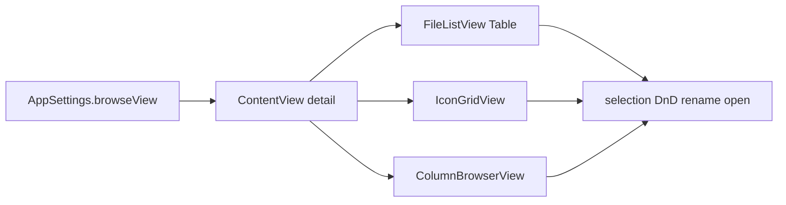

# Icon + Column Views (Windows switcher)

## Problem Statement

How might we let a Windows Explorer switcher browse folders visually (icons) and drill deep paths (columns) without leaving MacXplorer’s existing tree + mutation core?

## Recommended Direction

Ship two view modes on top of the current Details table, in this order:

1. **Icons** — Explorer Large Icons: grid of icons + names; same open / select / DnD / rename / trash as Details.
2. **Columns** — Finder-style Miller columns for deep navigation.

Toolbar segmented control: **Details | Icons | Columns**. Persist in `AppSettings` (UserDefaults). Default stays **Details**.

Audience A (Explorer familiarity via Icons first) + sprint pick 3 (views). No search, tabs, dual-pane, or Gallery in this slice.

## Key Assumptions

- [IconStore](Macxplorer/Services/IconStore.swift) can serve larger icons without breaking Details 16px rows (today `makeIcon` always sizes to 16x16).
- [InlineRenameField](Macxplorer/Views/InlineRenameField.swift) can work outside `NSTableView` (today rename focus looks for an enclosing table).
- Column mode reuses `BrowserModel.entries` for the focused column and keeps sidebar sync on folder open — no full BrowserModel rewrite for MVP.

## MVP Scope

### Slice 1 — Icons

- `BrowseViewMode`: `details | icons | columns` in [AppSettings](Macxplorer/Models/AppSettings.swift); restoreDefaults clears to details.
- Toolbar segmented control in [ContentView](Macxplorer/ContentView.swift) `actionToolbar`.
- Detail switch: keep [FileListView](Macxplorer/Views/FileListView.swift) for Details; new `IconGridView` for Icons.
- Extract shared list behaviors from `FileListView` (sort via `FileListOrder`, `selectRow`, `open`, drop hover, context menu) — do not fork mutation paths.
- `LazyVGrid`: ~64pt icon + name; Cmd/Shift multi-select; double-click open; Return rename; Cmd-Delete trash; folder drop targets.
- `IconStore`: size-aware cache keys; Details requests 16, Icons request 64.
- Unit tests for `BrowseViewMode` persistence/default.

Out of Slice 1: Columns UI, icon size picker, Gallery, List/Tiles.

### Slice 2 — Columns

- `ColumnBrowserView`: horizontal scroll of columns; each column lists one folder’s children.
- Selecting a folder appends/replaces the next column; selecting a file updates selection/preview only.
- Double-click file opens in default app; deepest folder drives [BrowserModel.navigate](Macxplorer/ViewModels/BrowserModel.swift) / sidebar pin.
- Reuse `editing.listSelection`, context menu, trash, rename in the active column cell.

Out of Slice 2: Gallery, per-column sort UI, folder-size calc.

### Slice 3 — Polish

- View menu: Details / Icons / Columns with Cmd-1 / Cmd-2 / Cmd-3.
- README documents the three modes.
- Manual check: select/drag/rename/trash/preview across all three modes.

## Not Doing

- Gallery / Content / Tiles / List — Icons covers the visual painkiller.
- Search / tabs / dual-pane — different jobs.
- Cut, Empty Trash, alias-on-drop — existing non-goals.
- Folder size calculation — README non-goal.
- Rewriting FileEditing / transfer stack — views sit on existing coordinators.

## Architecture decisions

- View switch: `ContentView` detail branch on `settings.browseView`
- Default: Details
- Icon size v1: fixed ~64pt (no slider)
- Icon cache: size-aware keys in `IconStore`
- Column sync: deepest folder column drives `model.selectedURL` / history like Details navigation
- Rename: generalize focus away from enclosing NSTableView only

## Files likely touched

- [Macxplorer/Models/AppSettings.swift](Macxplorer/Models/AppSettings.swift)
- New: `Macxplorer/Models/BrowseViewMode.swift` (+ tests)
- [Macxplorer/ContentView.swift](Macxplorer/ContentView.swift)
- [Macxplorer/Views/FileListView.swift](Macxplorer/Views/FileListView.swift)
- New: `Macxplorer/Views/IconGridView.swift`, `Macxplorer/Views/ColumnBrowserView.swift`
- [Macxplorer/Services/IconStore.swift](Macxplorer/Services/IconStore.swift)
- [Macxplorer/Views/InlineRenameField.swift](Macxplorer/Views/InlineRenameField.swift)
- [README.md](README.md) after Slice 3

## Verification

- `make tests` exit 0 after each slice
- `make run` — switch modes without losing folder
- Manual Icons: multi-select, drop into folder icon, rename, trash, Quick Look
- Manual Columns: drill 3 levels, Back works, sidebar pin matches deepest folder
